# 面向 ViT-Tiny 推理的 W8A8 FPGA 加速器设计与存储数据流优化

2026年全国大学生嵌入式芯片与系统设计竞赛

FPGA创新设计赛道 AMD 自主选题高级组

作品设计报告

目标平台 AMD VCU118    器件 xcvu9p-flga2104-2L-e

完整12层模型    静态W8A8    8×16 PE阵列    128 MAC

工具 Vivado 2023.2    当前物理候选 166.6667 MHz

证据截止 2026年11月03日19时36分38秒 北京时间

提交前由参赛者补全报名编号和署名；本稿不臆造人员身份或逐行代码归属。

当前结论：完整整机布线和时序通过，Bitstream已生成并下载。首次实板数值对比FAIL，1000个输出中921个不一致。当前Bank版完整12层L3回归尚未签收。

本作品采用参赛者自主硬件设计与大模型辅助工程验证相结合的开发方法。参赛者负责核心架构、关键设计决策与所声明的关键RTL设计，Codex辅助代码检查、测试自动化、实现分析与诊断。具体代码归属以贡献核对记录为准，待人工签认的内容不作为已证实的手写代码比例。

<!-- pagebreak -->

# 摘要

本作品面向VCU118平台实现完整12层ViT-Tiny整数推理计算链，研究重点为128 MAC计算阵列、片上Bank存储组织以及严格数值验证。模型包含197个Token、192维Embedding、3个64维Attention Head和1000类分类头。矩阵乘法采用静态W8A8，保留整数LayerNorm、Softmax、GELU和残差路径，利用Python整数参考、RTL检查点、布局布线和实板数据读回建立分层证据。

硬件采用四个4×8局部计算组构成8×16输出驻留阵列。DSP48E2配置AREG/BREG/MREG/PREG为1/1/1/1，通过同龄有效控制驱动内部P48反馈累加。每拍内部缓存提供8字节激活和16字节权重，在行列方向复用。计算结果经Bias、12级Requant流水及带credit的行队列写回ACT。参数与数据采用Bank组织，最近的修改加入本地写寄存、同步BRAM读及外部旁路，并显式等待写提交排空。

固定512张确认集上，FP32正确383张，W8A8正确377张，Top-1分别为74.8046875%和73.6328125%，相差1.171875个百分点，尚未达到不超过1个百分点的目标。历史jointfix版本完成257个检查点、11,532,400个数值及1000个Host输出逐位一致；该结果不能直接覆盖之后的Bank及控制修改。

Vivado 2023.2下，当前完整板级候选在166.6667MHz计算域完成布线，Setup WNS为+0.073ns，Hold WHS为+0.005ns，TNS和THS均为0；使用137个DSP、49,299个LUT及1,177.5个BRAM36等效块。首次板级测试完成配置、DDR校准和输出读回，但921/1000项与Golden不一致，两次读回完全稳定，根因仍在定位。报告保留此失败，不将Bitstream生成或Top-1碰巧一致表述为推理验收成功。

关键词：ViT-Tiny；W8A8；DSP48E2；输出驻留；BRAM Bank；逐位Golden；板级诊断。

表0-1 目标与现状

| 项目 | 目标 | 本稿证据结论 |
| --- | --- | --- |
| 网络 | 完整12层 | 计算与调度已集成；当前新版整网L3未签收 |
| 精度 | 下降≤1个百分点 | 512张上下降1.171875个百分点 FAIL |
| 频率 | 200MHz | 200MHz FAIL；166.7MHz完整整机物理PASS |
| 实板 | 1000输出逐位一致 | 921项不一致 FAIL；FPS与功耗NOT_RUN |

<!-- pagebreak -->

# 目录

- 摘要
- 第一章 选题背景与设计目标
- 第二章 算法结构与计算量
- 第三章 FPGA整体硬件架构
- 第四章 128 MAC计算阵列
- 第五章 片上存储与Bank数据流
- 第六章 控制调度与数据传输
- 第七章 功能与量化验证
- 第八章 优化特点与工程价值
- 第九章 自主设计与大模型协作
- 第十章 总结与后续工作
- 参考文献与复现边界
- 附录 关键身份与提交清单

阅读说明：报告中的PASS均附带对象和边界。NOT_RUN表示没有执行该项验收；BLOCKED表示缺少前置条件或证据；UNKNOWN用于根因及作者归属未定。设计目标、理论估算、软件精度、RTL仿真、真实布线与实板结果分开记录。

证据编号[e01]等指向report/evidence_index.md及其离线副本；原始文件路径和SHA保留在evidence/audit_facts.json。源码行号指向当前冻结快照，不以文件名替代真实实例检查。

版本简称：P为full128_bank_reset_fix_20261102；C为full128_jointfix_20261029；D为full128_downclock_bit_20261102/delivery_166p7。完整路径统一以D:/fpga/vit_tiny_vcu118为工程根。D:/xu未纳入本报告。

<!-- pagebreak -->

# 第一章 选题背景与设计目标

### 1.1 计算需求和应用价值

ViT通过Token间Attention建立图像全局联系，核心计算由线性投影、QK转置乘法、AV乘法与MLP组成[1]。相比只优化一个矩阵乘法器，完整推理还要求处理归一化、非线性、残差、数据重排和分类读回。FPGA的价值在于定制整数计算与存储数据流，但真实收益取决于整网调度和供数，不能由MAC数量直接推出。

本作品以完整ViT-Tiny作为可复现任务，保留Patch、位置编码、12个Encoder和CLS分类头。设计目标是在不删减模型结构的前提下，用W8A8减少主要矩阵运算的存储和乘法成本，并通过允许增加流水级和等待周期换取实现稳定性。板级正确性、精度和时序是分别验收的约束。

### 1.2 主要工程难点

第一，Activation、Weight、量化参数、程序与非线性LUT分布于大量BRAM，长距离互连和地址/使能扇出可能比乘法器本身更慢。第二，INT8矩阵结果必须与Bias、舍入、饱和和非线性数值合同一致，任何一拍错位都可能传播至分类头。第三，DDR、Host和计算域使用不同时钟，仿真模型不能替代真实MIG和CDC验收。

### 1.3 技术路线和取舍

项目复用128 MAC计算骨架，采用8×16阵列和分组本地寄存；在上层用共享AUX执行精确整数辅助算子，通过程序调度多类Bank。该选择优先控制功能风险与16GB开发环境的实现规模，并非已证明128 MAC或8×16是全部资源下的最优设计。512 MAC和独立重写工程均不作为当前参赛候选。

当前200MHz路线已有真实失败报告，因此交付候选改用实际MMCM产生的166.6667MHz计算时钟，并重新实现全板网表。频率下降不改变模型数学规则；它也不能补足当前Bank版未完成的整网L3或实板数值失败。[e01、e14—e26]

### 1.4 竞赛边界

AMD指南3.3允许高级组选用AMD器件，要求实际板级运行、源码、验证、构建脚本和Skill。2023.2虽非指南推荐的新版本，但属于允许说明后使用的其他版本。本报告据PDF原页22—25核查评分，不套用其他赛道规则。官方上传要求中的模板、签名授权、视频、仓库和照片仍须单独补齐。

<!-- pagebreak -->

# 第二章 算法结构与计算量

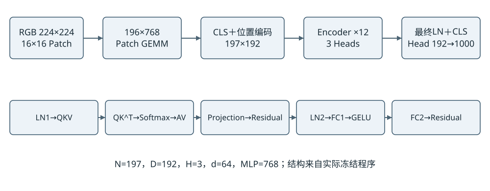

图2-1 当前完整ViT-Tiny计算结构 具体整数边界见本章

输入RGB图像经PC端固定预处理形成224×224×3字节。16×16 Patch展开为196×768矩阵，Patch投影输出196×192；拼入CLS并叠加位置编码后形成197×192。每个Block执行norm1、QKV、三头Attention、输出投影与残差，再执行norm2、FC1、GELU、FC2与第二次残差。最终norm只取CLS送入1×192到1000类的Head。

表2-1 冻结程序的真实矩阵工作量

| 类别 | M × N × K | 命令数 | 总MAC次数 |
| --- | --- | --- | --- |
| Patch | 196 × 192 × 768 | 1 | 28,901,376 |
| QKV | 197 × 576 × 192 | 12 | 261,439,488 |
| QKᵀ | 197 × 197 × 64 | 36 | 89,415,936 |
| AV | 197 × 64 × 197 | 36 | 89,415,936 |
| Projection | 197 × 192 × 192 | 12 | 87,146,496 |
| FC1 | 197 × 768 × 192 | 12 | 348,585,984 |
| FC2 | 197 × 192 × 768 | 12 | 348,585,984 |
| Head | 1 × 1000 × 192 | 1 | 192,000 |
| 合计 | 不含辅助算子与搬运 | 122 | 1,253,683,200 |

计算量由P/data/package/package.json逐条解析，原始122条记录见gemm_workloads.csv。FC1与FC2各占矩阵MAC的约27.8%，但MAC占比不能替代实际周期占比。旧V4的110条GEMM、37.05%局部周期收益不属于这一静态W8A8程序，故不混入当前性能结论。[h03]

<!-- pagebreak -->

## 2.1 W8A8与Requant数值合同

当前采用input_grid静态W8A8参数，不采用fc2b7_a16混合FP32候选，也不是逐Token动态INT8。每个Linear使用冻结INT8权重、输入Scale/Zero-point以及逐输出通道量化参数。存储文件中的整数M、R与Bias是实际接口合同，不能在RTL中临时重新估计。[e03、h01、h02]

$$
q_in = u_RGB8 − 128，s_in = 2/255，z_in = 0
$$

原归一化输入为2u/255−1，而q_in·2/255比它少1/255，该常量通过Patch Bias补偿。Host实际发送RGB字节的有符号编码，不把JPEG交给FPGA解码。权重50个数组未因input_grid编码改写，参数文件SHA固定。

$$
a_j = Σ_k x_k w_kj；b_j = a_j + B_j
$$

$$
y_j = sat8(RNE(b_j M_j / 2^R_j) + Z_j)
$$

累加在DSP内部保留P48，并检查有效输出可无损解释为INT32；Bias相加扩展到33位并检查溢出。软件参考用更宽整数计算后显式检查INT32边界，不能利用语言回绕掩盖溢出。M为正的U31，移位范围0至62；输出饱和到[-128,127]。输入/权重偏移补偿在打包Bias中固定，特殊AV补偿另行计算，避免重复减Zero-point。

RNE为最近偶数舍入：正负数先按幅值求商余数，余数大于半数时进位；恰半时仅奇数商进位，最后恢复符号。它与负数算术右移截断不同。以此保证Python、RTL与LUT生成器对半值和负值的一致性。

表2-2 实际整数接口

| 位置 | 格式 | 边界要求 |
| --- | --- | --- |
| Linear输入/权重 | signed INT8 | 输入已按本层Scale编码 |
| MAC与Bias | P48内部；外部INT32 | K与Bias全域约束及运行溢出检查 |
| RQ乘积 | signed64重组 | 4个部分乘积；不丢低位 |
| 输出 | signed INT8 | RNE、加Z、饱和顺序固定 |
| 原始QK | INT32 Score | 不直接用INT8线性RQ |
| Softmax/AV | U8概率；signed移码 | 精确补偿使AV数学不变 |

具体参考为C/software/golden.py，P/rtl/w8_requant_scalar.sv第57—81、114—163行；当前参数合同和NPZ分别由[h02、h01]绑定。量化数学规则的相同不代表之后存储/控制修改也已通过整网验证。

<!-- pagebreak -->

## 2.2 归一化与非线性整数实现

### LayerNorm

当前LayerNorm不是FP32调用。每行192维先按本层MI/RI重标到signed24 Q13网格，T为32位有符号求和，U为54位平方和。用V=192U−T²避免先除均值造成额外误差，再加入epsilon编码2,473,901。该编码对应冻结epsilon=10⁻⁶及Q13和192维统计缩放。

$$
W = 192U − T² + 2473901；root = floor(sqrt(W · 2^16))
$$

$$
inv = RNE(2^53 / root)；n_i = RNE((192q_i − T) inv / 2^25)
$$

W要求小于2⁶²，平方根操作数扩展到80位、root为40位，归一化结果和gamma/beta在Q20上仿射计算，并通过本层MO/RO/Z得到下游INT8。共享w8_math实现多拍精确乘法、除法和平方根；该结构节省并行宽算术，但吞吐代价明显，不能把GEMM峰值代表整网。

### Softmax与AV

QK的INT32 Score按SM/SR转为Q10，减去行最大值后，以非负差值查Q30 exp表。差值超过16384时输出0，16385项查表累计后计算p=RNE(255·exp/sum)。概率为U8，16位Probability存储的高字节为0；独立舍入不保证每行概率码严格和为255。

AV送入旧INT8核心前将概率移码为p_s=p_u8−128，并在点积外加128·ΣV。这样可精确计算原U8概率与INT8 V的乘积和。这里是已定义的数值补偿，不是另加一个旧16路Q14 AV模块。当前Softmax也不能冒称继承旧Softmax15全部物理或周期证据。

### GELU与Residual

GELU为每个通道256码LUT，共768×256=196,608个INT8条目；地址为channel×256+(x^0x80)。其离线数值近似已被Golden固定，运行期没有FP32或tanh硬件。残差用左右INT8与各自A20/B20系数形成宽整数和，经40位边界检查与重定标输出INT8。CLS和位置常量在Q20打包，不能省去位置编码。

源码：P/rtl/w8_aux_engine.sv、w8_math.sv；参考：C/software/golden.py、integer_ln.py；参数清单为parameter_inventory.json。所有本层系数均来自冻结参数，不把Block0系数套到后续层。上述为工程合同，不等于证明1个百分点精度目标。

<!-- pagebreak -->

# 第三章 FPGA整体硬件架构

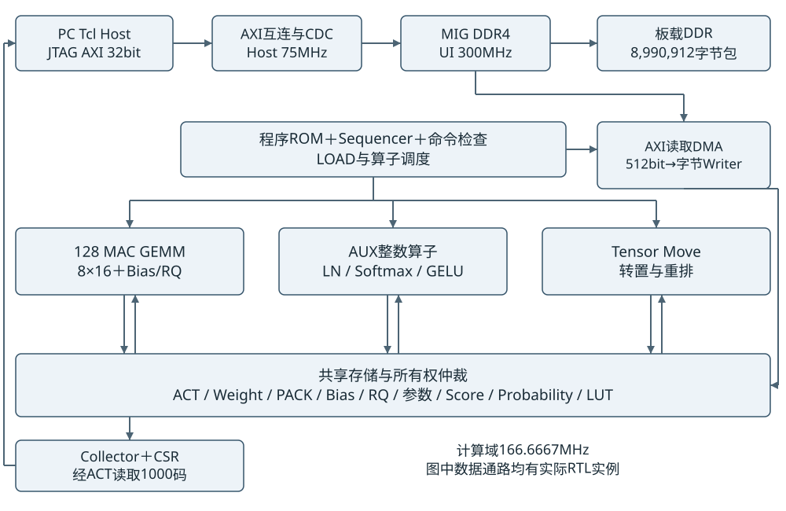

图3-1 当前板级候选真实模块与主数据通路

Vivado顶层为w8_platform_wrapper，板级计算封装沿w8_board_core→w8_hosted_core→w8_inference_core→w8_fsm_compute_system实例连接。下层w8_compute_system连接DDR读取DMA、字节Writer、计算Tile和真实Bank存储；Tile在GEMM、AUX与Tensor Move之间选择。Collector从实际ACT读取最终1000个字节，Host不直接装入预期输出。[e02、e27、e44]

PC负责冻结预处理、DDR包传输与读回比较；FPGA负责程序顺序、整数计算、写回和结果收集。当前传输通道为JTAG AXI，不含CPU、PYNQ、PCIe或相机前端。图中的DDR容量标签表示本次输入包大小，不是板载DDR总容量。

整体设计没有已验证的全网LOAD/计算双缓冲重叠：load_ready/cmd_ready依据tile_busy、所有权、memory_writes_pending、Writer和DMA状态互斥放行。该简单协议有助于正确性，却限制吞吐，是后续可量化优化点。

<!-- pagebreak -->

## 3.1 模块实例与版本继承

表3-1 当前主要模块及继承状态

| 功能 | P下真实文件 | 当前作用及验证边界 |
| --- | --- | --- |
| 顶层与Host | board/w8_board_core.v；rtl/w8_hosted_core.sv | 板级封装/CSR/Collector，真实板上读回已执行但数值FAIL |
| 全网调度 | w8_fsm_compute_system.sv；w8_program_sequencer.sv | 实际程序ROM驱动13,024条指令 |
| GEMM控制 | w8_gemm128.sv；w8_quant_tile.sv | 8×16供数、Bias、RQ与ACT写回；局部真实数据测试PASS |
| 128 MAC | w8_mac_array_local.sv；legacy/v2_mac_group4x8.sv；legacy/v2_c0_mac_cell.sv | 复用C0及四组阵列，实际128 DSP结构通过 |
| 整数辅助 | w8_aux_engine.sv；w8_math.sv | LN/Softmax/GELU/Residual；C整网PASS，P只有对应局部证据 |
| 数据搬运 | w8_tensor_move.sv | QKV拆分、转置及布局转换 |
| Bank | w8_act_local_ram.sv；w8_memories.sv；vendor_byte_banks.v | 最新写提交/读延迟/旁路版本；L1/L2 PASS |
| DMA | legacy/tiny_axi_read_dma.v；tiny_dma_byte_writer.v | AXI512输入转换为逐字节Bank装载 |
| 结果 | legacy/tiny_result_collector.v；tiny_axi_lite_control_v128.v | 1000码收集/250字打包/有符号argmax |

P的sources.json与真实实例共核查25个计算及板级封装源文件，而不是用工程名称判断网络完整性。当前冻结清单505项全部SHA一致；实际综合输入另有172项RTL、头文件和初始化数据身份核对。[e01、e02、e37]

历史C完成静态W8A8整网Golden；P保留相同模型/量化参数与128 MAC结构，但相对真正L3验收对象有11个相同、14个修改或新增的活动源文件。最近一轮CHANGED_FILES只有3项，不能用它掩盖此前累计接口变动。旧V4、Softmax15、R1/R2以及独立D:/xu均不能替P提供跨版本PASS。

<!-- pagebreak -->

# 第四章 128 MAC计算阵列

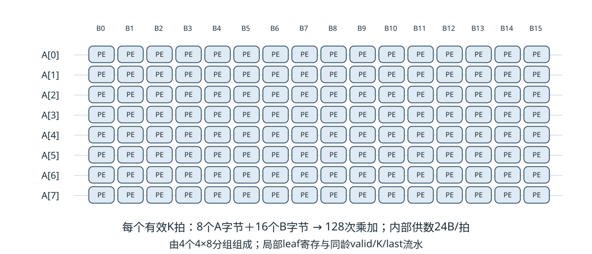

图4-1 8×16输出驻留阵列 四个4×8本地组

Tile以8行Activation与16列Weight为一个输出块，128个PE分别持有一个C[r,c]累加值。K推进时，同一行A广播给16个输出列，同一列B广播给8个输出行。四个4×8组共用数学时序，但采用局部输入寄存和同龄valid/reset/flush分发，限制广播末端物理范围。

$$
C[r,c] ← C[r,c] + A[r,k] B[k,c]，0≤r<8，0≤c<16
$$

8×16选择与16个字节Bank、128位Weight读取和既有4×8组复用相适配，减少单拍广播输入数量；缺点是M/N尾Tile和供数、RQ排出开销。N=197时列方向需13块，填充到208列；M=197行方向需25块，填充到200行；Head1000列需63块填充到1008。keep屏蔽无效结果，不能将填充作为有效计算吞吐。

表4-1 同为128 MAC的理论组织比较

| 组织 | 每拍不同A/B字节 | 主要取舍 |
| --- | --- | --- |
| 1×128 | 1+128=129 | 适合M极小但权重扇出和128列供数要求大 |
| 2×64 | 2+64=66 | 减少行并行度，列方向仍较宽 |
| 8×16 | 8+16=24 | 复用率较高；行列尾Tile、缓存和结果队列仍有成本 |

表4-1是假设每拍一个K、理想广播的理论比较，未对前两种做同条件P&R。连续MAC II=1只覆盖有效RUN窗口；完整Tile还要装载、clear、排空、Requant和写回。166.7MHz下128 MAC理论为21.33GMAC/s，不能写成实测吞吐。

<!-- pagebreak -->

## 4.1 DSP48E2流水与累加

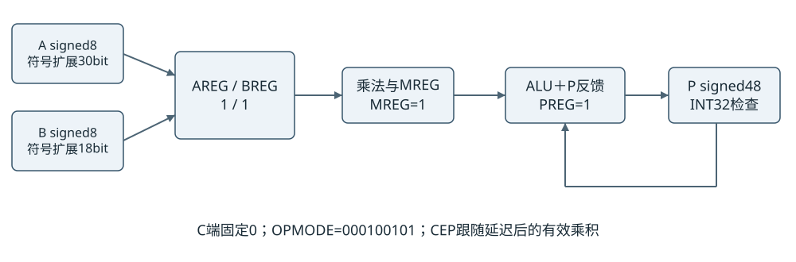

图4-2 单PE内部乘法和P48反馈数据通路

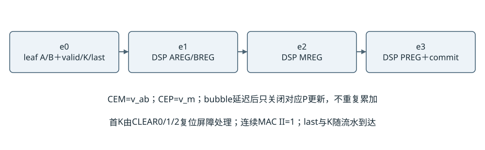

图4-3 本地叶寄存到DSP累加提交的同龄流水

v2_c0_mac_cell将signed8 A/B分别符号扩展到30和18位接口，利用DSP48E2的有符号27×18乘法和P寄存反馈。AREG、BREG、MREG、PREG均为1，OPMODE=000100101，C端为0，P←P+A×B。take控制输入寄存，v_ab控制CEM，v_m控制CEP，bubble不更新累加；commit_valid表示该拍CEP已经提交。

在DSP单元边界，e0输入A/B，e1乘积M，e2累加P；包含分组叶寄存后，整体再向前增加一拍，K和last按相同年龄传播。flush/reset清理有效流水和任务状态。局部复制带KEEP/DONT_TOUCH，但最终是否复制、DSP属性是否保留，仍以mapped/routed检查为证据。[e38]

实际源码为legacy/v2_c0_mac_cell.sv第6—85行、v2_mac_group4x8.sv第3—47行、w8_mac_array_local.sv第10—77行。128个核心DSP的1/1/1/1已在最终网表结构检查中确认；整机137个DSP并非137 MAC，余下9个属于其他映射算术，报告不凭数量分配其功能。

<!-- pagebreak -->

## 4.2 供数缓存与Bias Requant写回

w8_gemm128从真实存储读入Tile缓存，并区分普通Linear、原始QK和AV。A缓存768×64位、B缓存768×128位，覆盖本网络最大K=768。RUN阶段同步读后用read_v0、read_v1及四个同龄local_read_v1补偿数据延迟，CLEAR0/1/2避免前任务残留；最后有效乘积提交后才进入结果收集。

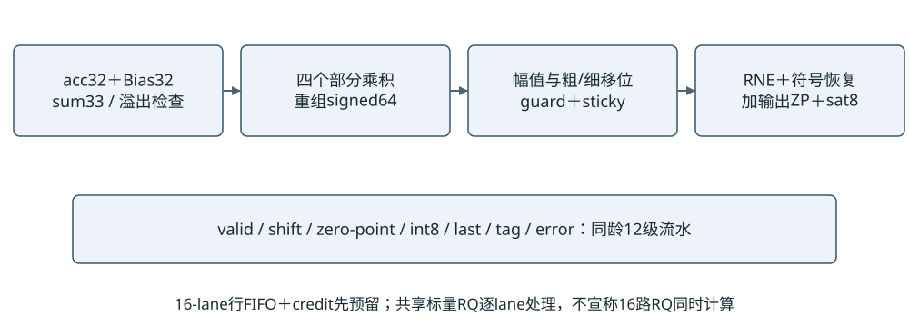

图4-4 标量Requant流水与行队列的真实组织

w8_rq16的名称表示16-lane行协议，不是16个标量RQ并行。其16项预留行FIFO先获取credit，再接收原始行；验证expected_tag、keep和参数后逐lane送入共享12级RQ流水。Tag比较按8组16位组织，参数720位按16×45位分组选择，减少长路径。backpressure时CE同时保持数据、valid、last、tag及错误状态。

RQ先把acc与Bias相加到33位检查边界，再通过17位分段的四部分乘积构成signed64。粗/细移位保留guard和sticky执行RNE，然后恢复符号、加Z与sat8。它没有改变冻结数学顺序；流水化只改变延迟。AV另从weight_sum生成补偿Bias，必须与对应Tile/K一致。

量化行输出后，GEMM按实际M/N边界把有效字节写回ACT。DRAIN要求队列和存储写提交均排空，才向上层报告完成。局部Head测试覆盖真实GEMM、ACT、Collector和Host，不使用Golden输出填充ACT；测试范围仍不等于完整12层。

依据：w8_quant_tile.sv第19—184行；w8_rq16.sv第13—68行；w8_requant_scalar.sv第57—163行；w8_gemm128.sv第37—425行。完整参数选择与写回地址见活动源文件索引。

<!-- pagebreak -->

# 第五章 片上存储与Bank数据流

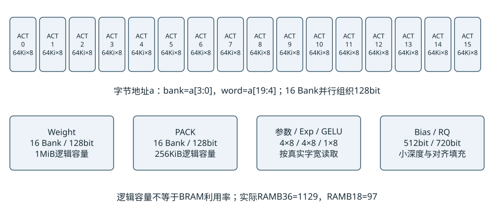

图5-1 主要片上存储类别与访问宽度

表5-1 逻辑存储容量与布局

| 类别 | 逻辑配置 | 用途及注意事项 |
| --- | --- | --- |
| ACT / Weight | 各16×64Ki×8；各1MiB | 低4位选bank，行列重排后并行访问 |
| PACK | 16×16Ki×8；256KiB | 供转置与数据整理 |
| 参数 / GELU / Exp | 256 / 256 / 128KiB | GELU实际196608字节；Exp实际65540字节 |
| Score / Probability | 256 / 128KiB | INT32 Score；U16容器存U8概率 |
| Bias / RQ | 4096 / 5760字节 | Bias允许distributed RAM；RQ记录有padding |
| 程序ROM | 13024×512位；833536字节 | LOAD/算子命令与END，不是概念性FSM |
| Tile A / B | 768×64 / 768×128位 | 内部24字节/有效K拍 |

表中为RTL逻辑分配，不等于物理BRAM总和。实际映射受端口宽度、深度、Bank碎片、DDR IP和程序ROM影响。当前RAMB36=1129、RAMB18=97，等效1177.5个36Kb块，占器件BRAM约54.51%；DSP只占2%，说明继续增加MAC前需要先审查存储容量与搬运。

大型数组通过ram_style=block与综合结构检查约束BRAM映射；但“所有LUTRAM为零”并非本设计目标。最终LUT as Memory为3236，其中distributed2348、SRL888；Bias小数组等有明确例外，不能把允许的控制/小存储误判为大缓存回退。

<!-- pagebreak -->

## 5.1 Bank写提交与旁路一致性

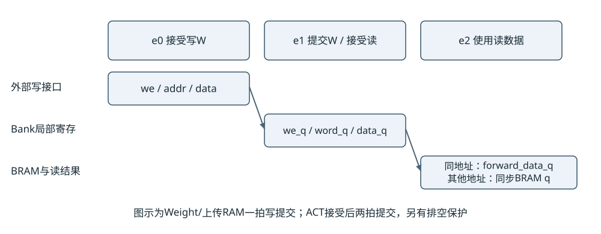

图5-2 Bank本地写寄存和同步读旁路示意

此前Bank写使能、地址和字节数据从集中Writer直接扩散，形成高扇出或长线。当前vendor_byte_banks在每个Bank用we_q、word_q、data_q捕获请求，下一拍才提交BRAM，因此逻辑可见性必须显式增加一拍，而不是只插寄存器后假定完成信号不变。

同拍读请求如果命中待提交写，RAM原生读值与仿真读写模式可能不同。当前实现保留纯同步q<=bytes[rd_addr]推断形式，将forward_data/forward_valid寄存后放在BRAM输出外选择，实现规定的写后读可见性。曾把读旁路mux写在q赋值中导致LUTRAM推断失败，此失败记录保留，最终采用外部旁路。[e11、e12]

写请求已被接受后，reset不能悄悄丢弃提交；31次“接受后复位”用例和故障注入对此检查。上层用write_pending合并局部待写状态，并在DRAIN/所有权切换前等待，不让下一个AUX/GEMM读取旧字节。地址边界、每个Bank低位选择及同拍数据优先级均需要逐拍验证。

CASCADE_HEIGHT=2限制BRAM级联，局部寄存减少驱动距离是合理结构性措施；但没有只改变这一项的同条件整机P&R对照，不能独立归因“该寄存器使频率提高”。200→166.7MHz收敛同时涉及真实时钟改变和重新物理实现。

表5-2 当前Bank局部证据

| 检查 | 实际规模 | 结论 |
| --- | --- | --- |
| 接收/写入/复位 | 462690字节比较，2395次写，31次接受后reset | PASS 局部 |
| ACT满深度 | 65536个word，263172次字节检查 | PASS 局部 |
| ACT接口 | 153个响应、9456字节及12274个scalar检查 | PASS 局部 |
| AUX / Head | 1866值；Head两任务各1000码 | PASS 局部；不覆盖完整12层 |

<!-- pagebreak -->

## 5.2 ACT地址读取延迟与所有权

ACT为16个字节Bank。对字节地址a，bank=a[3:0]、word=a[19:4]，16个连续字节可用wide通道并行读取。标量和宽读在接口中有不同管线：当前记录的接受到标量响应为5个边沿、宽响应为6个边沿；AUX与Move显式配置对应读取延迟。接受、内部BRAM提交与响应有效三个时刻不能混为一拍。

ACT写入由raw请求寄存、本地写队列和Bank提交组成，总体接受到提交为两个边沿。wide_mode、碰撞位和rsp_ready决定读是否可接收，停顿期间响应必须保持。compute_system以compute_owner_q和memory_writes_pending保护DMA、GEMM、AUX、Move、Host之间的所有权，Host结果读要求计算已结束且存储可见。

表5-3 数据生命周期和复用

| 对象 | 产生者 → 使用者 | 生命周期/复用规则 |
| --- | --- | --- |
| 输入与权重包 | PC → DDR → DMA →各Bank | DDR包常驻；片上Weight按阶段装载复用 |
| 主激活/残差 | Patch/Projection/FC2 → ACT → LN/残差 | 由程序地址控制复用；未用完不能覆盖 |
| Q/K/V与转置 | QKV → Move/PACK → QK/AV | 按Head拆分和布局转换 |
| Score与概率 | QK → Score → Softmax → Probability → AV | 按Head/阶段复用，不是FP32矩阵 |
| 量化及非线性参数 | DDR → Bias/RQ/参数/LUT | 当前命令前装载；写提交排空后才能消费 |
| 最终分类 | Head → ACT 0x84000 → Collector → CSR | 1000码收集完成后供Host读取 |

这套内存没有被强行替换成早期独立v2_gemm128_memory：当前W8A8板级快照使用自己的w8_memories、ACT及动态字节Bank链路。报告以真实实例为准，不把旧R2完整tiny_compute_buffers实验与当前W8A8写成同一份源代码。

实现证据：P/rtl/w8_act_local_ram.sv第26—122行；w8_compute_system.sv第44—131行；vendor_byte_banks.v第22—53行；w8_memories.sv第2—148行。当前相对C累计14项修改/新增，最新P完整L3仍NOT_RUN。[e37]

<!-- pagebreak -->

# 第六章 控制调度与数据传输

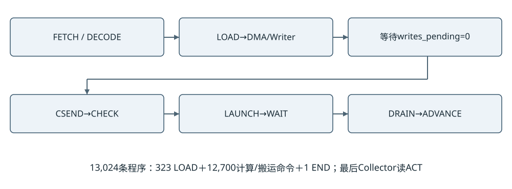

图6-1 实际顺序调度与写提交排空流程

w8_program_sequencer通过$readmemh加载512位指令ROM，状态为IDLE、FETCH、DECODE、CSEND/CWAIT、LSEND/LWAIT和ADVANCE。部分历史注释称“无程序ROM”，与当前实际代码不符；本稿按真实实例说明。固定程序包含323次LOAD、12700次非LOAD命令及1条END。

每条计算命令先经w8_command_check完成维度、地址、乘积范围等检查，非法命令在产生副作用前拒绝。w8_compute_tile再路由到GEMM、AUX或Move，等待运算及写提交排空。为了保证跨算子数据可见，当前LOAD和计算严格互斥，不宣称实现了未验证的全网预取重叠。

AXI读取DMA发出512位、ARsize=6的64字节传输，检查对齐、4KiB边界、响应错误和last。返回Beat由tiny_dma_byte_writer逐字节写入对应Bank，接受新Beat依赖Writer空闲。AXI总线512位只是接口宽度；当前不能据此宣称每拍64字节连续存储吞吐。

程序常量、地址和参数被打包在ddr.bin及program文件，数据包为8,990,912字节。通过JTAG上传加读回的时间含验证开销；它不是DDR峰值带宽，也不能与FPGA内核周期直接相加推算稳定FPS。

降频准备入口为experiments/full128_downclock_bit_20261102/prepare_integer_clock.py（e43）；对应板级构建Tcl和同一实验的board_kit_166p7/first_test.tcl、host_w8.tcl负责实现与板测。报告仅审查已有产物，不在本轮重新执行这些硬件或构建动作。

<!-- pagebreak -->

## 6.1 时钟复位CDC与Host协议

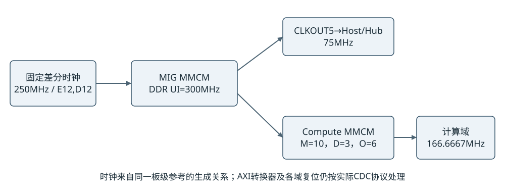

图6-2 真实时钟来源与各域接口边界

板载250MHz差分输入驱动DDR4 IP；MIG UI为300MHz，Host由调试时钟得到75MHz，compute Clock Wizard从300MHz经MMCM M=10、D=3、O=6得到1000MHz VCO及166.6667MHz输出。D与旧200MHz候选相比实际改了Clock IP并重新综合/布局布线，不是仅改XDC。

LOCKED及各域复位由IP复位网络管理，AUX复位极性修复已保留。AXI宽度转换、异步时钟转换与FIFO由真实厂商IP实现。有效XDC Setup用户uncertainty=0.100ns，Hold=0.050ns，最终路径还叠加时钟抖动等项。频率CSR只表示配置身份，不能当作外部测频。

表6-1 Host CSR与结果ABI 相对0x80000000

| 偏移 | 内容 | 规则/本次实板值 |
| --- | --- | --- |
| 0x00 / 0x04 | 启动/状态 | start=1；空闲reset=2；状态busy/done/error/cal/valid |
| 0x08 / 0x0c | top1 / max_logit | 有符号比较；实板65 / 87 |
| 0x10..0x1c | job/core 64位计数 | 低/高字读取；不含上传和Host结果传输 |
| 0x20 / 0x24 / 0x28 | retired / commands / loads | 13023 / 12700 / 323 |
| 0x2c / 0x30 | 指令数 / 输出数 | 13024 / 1000 |
| 0x34 / 0x38 / 0x3c | 身份 / 频率 / MAC | 0x56313238 / 166666666 / 128 |
| 0x1000..0x13e4 | 250个32位结果字 | 每字4个little-endian INT8，依类别顺序 |

AXI-Lite独立捕获AW和W，B/R响应在背压时保持；Collector读取真实ACT并打包，argmax并列时取先出现的类别。对ABI、DDR校准、忙/错状态的保护条件不能为方便测试而删除。

<!-- pagebreak -->

# 第七章 功能与量化验证

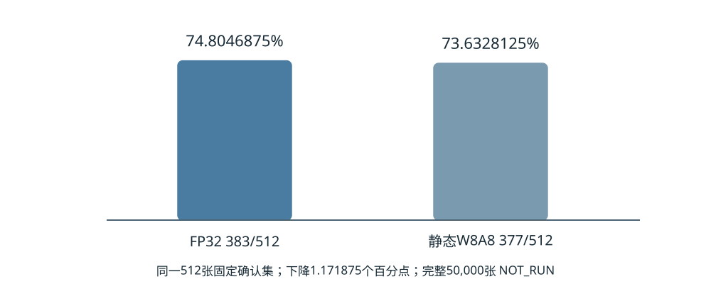

图7-1 固定512张确认集Top-1 实际目标仍未达成

CONFIRMATION.json及其原生退出记录对应同一固定512张确认集：FP32为383/512，74.8046875%；W8A8为377/512，73.6328125%。差6张，即1.171875个百分点。该结果是样本确认，不是ImageNet验证集50000张精度；全量评测NOT_RUN。Top-1目标不超过1个百分点应明确标FAIL，用户接受当前基线并不改变这个事实。[e03—e05]

表7-1 功能验证对象与结果

| 对象 | 真实覆盖 | 状态 |
| --- | --- | --- |
| 历史C jointfix整网 | 257检查点/11532400值/1000实际Host输出 | PASS 历史精确绑定 |
| 历史原生仿真 | 104355.831秒；xsim/kernel退出与dump检查 | PASS 工具验收 |
| 当前P Bank及算子 | 21次有限XSim运行含8次预期负例故障注入 | PASS 对应L1/L2 |
| 当前P完整12层L3 | 相对C有14项活动源码修改/新增 | NOT_RUN 不跨版本继承 |
| 首次板级固定输入 | 1000读回；921项与Golden不同 | FAIL |

C的实际周期为1,282,750,775，其中LOAD 10,209,170、compute 1,272,460,010、schedule 77,817，Collector另计2000。前三项互斥统计，compute包含所有算子和等待，日志不能据此拆出独立LN/Softmax/GELU周期。运行约29小时是仿真耗时，不是硬件推理延迟。[e06—e10]

故障检查包括输出checker篡改索引37，以及局部DDR SLVERR等；它们不等于第二次完整错误期望网络仿真。对每次FI，报告“错误被检出”的checker PASS，并保留负例日志，不把预期Fatal误判为正常数值输出PASS。

<!-- pagebreak -->

## 7.1 完整整机资源与布线时序

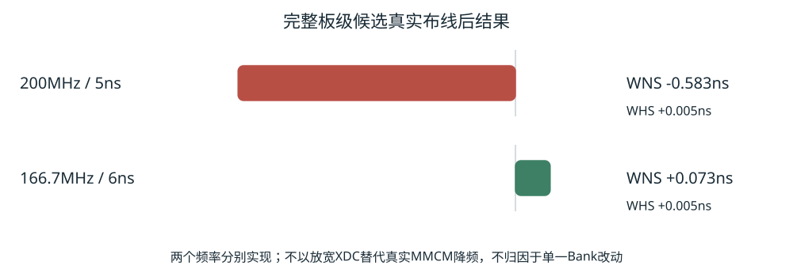

图7-2 完整板级200MHz失败与166.7MHz通过的真实时序

表7-2 两个完整板级实现结果

| 项目 | 200MHz历史Route | 166.6667MHz当前D |
| --- | --- | --- |
| WNS / TNS ns | −0.583 / −217.731 | +0.073 / 0 |
| Setup负端点 | 1744 / 223283 | 0 / 223194 |
| WHS / THS ns | +0.005 / 0 | +0.005 / 0 |
| Hold负端点 | 0 / 222374 | 0 / 222285 |
| WPWS / 脉宽失败 | +0.039ns / 0 | +0.039ns / 0 |
| 布通 / 可布网络 | 124191 / 124191 | 123520 / 123520 |
| LUT / Register | 49874 / 59120 | 49299 / 59093 |
| DSP / RAMB36 / RAMB18 | 137 / 1129 / 97 | 137 / 1129 / 97 |
| URAM / 结果 | 0 / TIMING_FAIL | 0 / BITSTREAM_GENERATED |

当前LUT占4.17%，Register占2.50%，DSP占2.00%，BRAM36等效占54.51%。报告中的59,093为CLB Registers，其中Flip-Flop 59,092和1个AND/OR寄存单元，无锁存器。137个DSP中的128个用于MAC阵列，其他映射算术另计。

全部适用时钟检查后，D没有未布通网络，no_clock、意外内部unconstrained、generated-clock错误和组合环检查为0。sys_rst无输入延迟与DDR reset输出无输出延迟属于已说明的异步复位边界；没有为数据通路新加虚假false path或multicycle。[e15—e23、e38—e40]

<!-- pagebreak -->

## 7.2 关键路径与告警审查

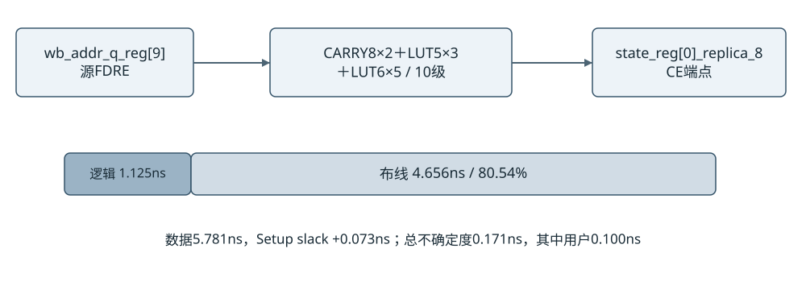

图7-3 当前最差Setup数据延迟分解 主要为布线延迟

166.7MHz最差路径为gemm/wb_addr_q_reg[9]到gemm/state_reg[0]_replica_8的CE，10级逻辑，数据延迟5.781ns，其中Cell 1.125ns、Net 4.656ns，Net约80.54%；skew +0.085ns，总uncertainty 0.171ns。WNS仅+0.073ns，仍是低余量版本，不能预测200MHz只需某一处寄存器就必然通过。[e17]

表7-3 路径族查询的最差Setup与Hold ns

| 路径族 | Setup | Hold |
| --- | --- | --- |
| BRAM地址 / DSP控制 | +0.142 / +1.134 | +0.042 / +0.051 |
| MAC / Bias-RQ | +1.266 / +0.417 | +0.037 / +0.005 |
| AUX / Scheduler | +0.756 / +0.422 | +0.012 / +0.017 |
| 写回Move / ACT→A-cache | +1.603 / +1.529 | +0.011 / +0.038 |
| ACT请求 / Bank请求 | +0.467 / +0.151 | +0.034 / +0.196 |
| DMA Writer | +0.629 | +0.017 |

路径族表是特定get_pins筛选集合，并非全局WNS分解。例如BRAM_to_DSP筛选无匹配应记NOT_PRESENT，不能写成系统没有BRAM瓶颈。200MHz最差Weight BRAM路径为4.656ns数据延迟，其中3.273ns为Net，另有程序BRAM、GELU、ACT和reset/control违例；修复不能只盯乘加核心。

DRC为0 Error、0 Critical、17 Warning和128 Advisory。Warning族包括DPIP-2、DPOP-3/4、PDCN-1569、REQP-1857/1858及RTSTAT-10；AVAL-155为128条Advisory。CDC为206条CDC-3 Info、17条CDC-9 Info和4条CDC-15 Warning，后者位于vendor Debug Hub CMD6 FIFO。已有WARNING_REVIEW分类，但不能描述为零告警或已用实板证明全部无害。[e20、e21、e24]

<!-- pagebreak -->

## 7.3 首次真实板级测试结果

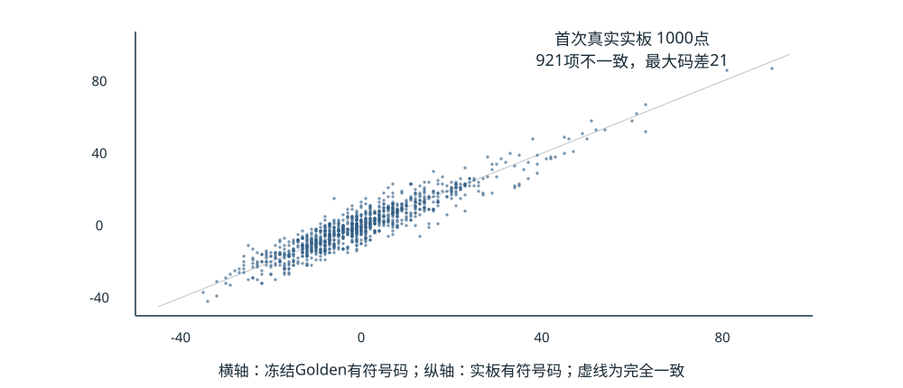

图7-4 首次实板与Golden的1000码比较 横纵坐标均为signed INT8

VCU118已实际下载对应Bitstream，Hardware Manager截图显示Programmed、MIG CAL PASS及JTAG AXI对象。first_test进入分类结果对比，随后保存的只读诊断分别读取250个32位字，两遍共2000码。两遍之间零差异，说明该次结果读取稳定；这不证明结果数值正确。[e27—e32]

表7-4 同一完成任务的实际读回

| 项目 | 实测结果 |
| --- | --- |
| 全部码比较 | 1000项中921项不同；79项相同 |
| 首个差异 | index0：actual 18/0x12；expected 13/0x0d |
| Top-1 / 最大码 | 两者Top-1均65；实际最大87，Golden最大91 |
| 误差统计 | 最大绝对码差21；MAE 4.065；RMS 5.225227 |
| 稳定性 | pass1与pass2：1000项零差异 |
| 任务计数 | retired13023；commands12700；loads323；results1000 |
| core / job周期 | 1306518791 / 1306524792 |

按配置6ns推导，失败任务core约7.839112746秒、job约7.839148752秒，后者多6001拍。该值仅是失败任务计数及配置频率换算，不是已验收推理FPS；没有稳态多次测量或功耗数据。固定图像标签65且预测也为65，不能抵消921项逐位差异。

检查全部24种字内字节排列也不能完全匹配；稳定读取和最大码变化只缩小问题范围，尚不能确认是Bank、时序、DDR、量化参数还是其他原因。根因为UNKNOWN，未发布修复成功结论。

<!-- pagebreak -->

## 7.4 数值故障定位与当前回归边界

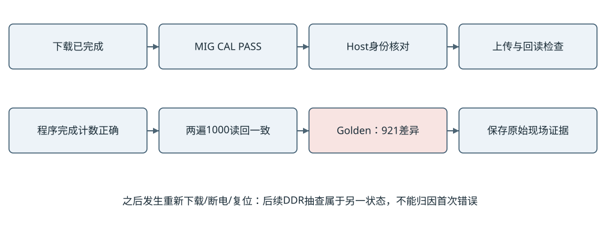

图7-5 板级故障定位流程和会话连续性保护

首次结果取证之后，用户确认曾重新下载、断电或复位。重新绑定唯一AXI后，身份、频率和MAC元数据正确，但状态0x08、retired和loads清零。此时340个DDR单字抽样全部不同，出现0、FFFFFFFF与33333333等模式。它只描述新的空闲会话，不能倒推首次推理921项错误由DDR损坏引起。[e32、e33]

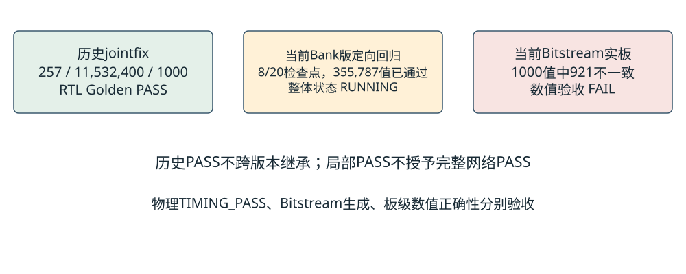

图7-6 历史全网与当前定向回归的覆盖分开记录

当前定向RTL回归于17:47开始，使用P精确同源计算/板核、真实DSP48E2与UNISIM模型以及冻结DDR包的AXI协议模型；最多20检查点、989142个值，范围到Block0结束，不包含实际MIG、MMCM或物理CDC。报告19:36截点已通过8个检查点，共355787值；最新通过attn0.1.score，进度pc490、48,000,000周期。尚未发现差异，状态RUNNING，不是整网PASS。[e34—e36]

原有进程由独立监控保持，本次报告任务不终止、不重启、不改变输入。后续若在首个不一致处停止，应先核对字节、地址、写提交和消费者读延迟，再对受影响模块短测；若20点均通过，也只能缩小到模型覆盖后的范围，不能签收全部12层或板级DDR。

<!-- pagebreak -->

# 第八章 优化特点与工程价值

表8-1 可追溯的技术特点 不把通用技术包装为原创发明

| 问题 | 具体方法与基线区别 | 证据与限制 |
| --- | --- | --- |
| 乘加流水/有效年龄 | C0 P48反馈、1/1/1/1及四个4×8局部组 | 128 DSP映射与局部前缀对拍；DSP流水本身为通用技术 |
| 供数复用 | 8A+16B广播到128输出；真实A/B缓存 | 源代码和局部供数验证；未达到整网峰值利用率 |
| Bank长线和写可见性 | 本地写寄存、外部同步读旁路、pending排空 | 局部/深度/复位FI通过；新L3和实板仍未通过 |
| 精确整数算子 | 冻结RNE、整数LN、Softmax、GELU及AV移码补偿 | C历史L3通过；512张精度损失1.171875个百分点 |
| 实现与证据闭环 | 源SHA→原生退出→数值→布线→实板分层 | 166.7MHz物理通过；当前板级FAIL如实保留 |

### 8.1 能确认的优化收益

当前真实物理比较证明：200MHz同类全板候选Setup失败，而实际降频并重建后的166.7MHz完整候选全部Setup/Hold和脉宽检查通过，成功生成Bitstream。这是工程交付收益，代价是计算周期对应时间增加约20%；没有仅改变Bank寄存或单个策略的隔离实验，故不做单因素频率归因。

理论矩阵工作量除以128给出约979万有效MAC拍的下界；历史整网却为12.83亿拍，表明整体受辅助串行算术、数据搬运、RQ/写回及调度开销影响。现有整网日志没有足够的独立算子周期分解，不能自行把差额分配到LN或Softmax。下一轮应在真实模块边界加计数并验证重叠关系，再决定优化顺序。

### 8.2 不足与可复用性

本地复制、BRAM同步读模板、写提交一致性和分层Golden方法可以复用，已提炼为独立Skill。但未获得本版实板数值通过、稳定FPS或能效，不能宣称实时、高效领先或达到竞赛性能目标。工程特色在完整链路与可追溯验证，而非已证实的新颖算子或最优阵列。

<!-- pagebreak -->

# 第九章 自主设计与大模型协作

### 9.1 实际职责和贡献审核

依据参赛者的项目声明，参赛者负责ViT计算需求、整体架构、PE/存储数据流、关键RTL设计与方案取舍，并参与评审和实际板级操作。Codex用于实现辅助、代码审查、Python Golden、Testbench、Tcl自动化、资源/时序分析及板级故障定位。具体哪些行由参赛者独立编写，不能仅从最终文件倒推出。

表9-1 贡献描述与证据强度

| 内容 | 可核查记录 | 报告采用的表述 |
| --- | --- | --- |
| 架构与目标决策 | 对话中批准128 MAC、冻结数值与串行构建、要求保留证据 | 参赛者主导目标与技术取舍 |
| 关键计算RTL | 实际C0/阵列/GEMM源码、验证和网表 | 真实设计存在；逐行自主编写归属需人工确认 |
| AI辅助实现/检查 | 实验run.py、Testbench、Vivado脚本与迭代记录 | Codex辅助或共同迭代，不能全部归为手写 |
| Golden与故障注入 | 历史原生日志、源绑定、checker测试 | AI辅助自动化；人工审核验收边界 |
| 实际上板 | 用户Hardware Manager截图、Tcl输出和会话说明 | 参赛者执行硬件操作，Codex辅助分析 |
| 历史版本作者 | Git近期提交作者均为Codex；大量实验未追踪 | Git不支持个人逐行署名；需补设计笔记/原始提交 |

### 9.2 典型协作纠错

BRAM旁路最初放在同步读赋值内导致存储推断问题，后通过保持纯RAM读模板、外置旁路并运行逐拍测试恢复结构。另一例是初次921项实板差异：AI辅助生成只读双次结果取证，而非重算覆盖现场；用户之后复位导致会话变化，分析明确撤回“后续DDR样本可直接解释首次错误”的潜在推断。这些记录体现AI需接受数值、结构和会话边界的约束。

本次文档及Skill整理也由Codex辅助完成。报告不删除AI协作事实，不提供未经核验的“全部原创”或手写比例。contribution_review.md列出待人工确认项，建议提交前由每名成员签认负责模块和原始证据。

<!-- pagebreak -->

## 9.3 可复用Skill及使用证据

表9-2 本次整理的三个Skill候选

| 目录 | 输入与输出 | 实际证据及边界 |
| --- | --- | --- |
| fpga-golden-check | expected/actual字节与原生退出记录→首差异/数量/状态 | 历史257点流程与1000码取证；不重新运行RTL |
| vivado-evidence-audit | 原始时序/资源/时钟与SHA→分阶段检查 | 实际200/166.7MHz报告；DRC/CDC另需人工分类 |
| fpga-board-diagnosis | ABI/状态/会话/双读回→分阶段诊断 | 本次实板921错例；不包含自动硬件写命令 |

每个目录提供SKILL.md、README、scripts/check.py和references/evidence.md。依赖为Python标准库；输入为冻结文件副本，输出为JSON及人工审核建议。该打包是本次新增产物，来自本工程已使用流程，不宣称已经在其他工程独立验证。跨项目验证NOT_RUN，板级根因修复同样未完成。

本轮只运行15项离线helper自测：真实1000码同码比较、索引37位翻转、921项实板差异再现、数量不等、原生exit0但有dump拒绝、实际Timing Summary解析、负Setup/Hold/Pulse及非零TNS/THS/TPWS注入、板级FAIL保留与复位后因果保护。15/15通过不等于新跑了15项FPGA功能测试。[skill/selftest_results.json]

### 9.4 适用条件与失败处理

Golden Skill要求单行双十六进制字节，不自动猜测有符号文本、端序或输出长度。Timing Skill必须先绑定源和约束，原始表格未唯一匹配时停止；即使Setup/Hold全过，也不省略路由、时钟、DRC、CDC和功能检查。Board Skill在会话连续性缺失、AXI句柄不唯一、DDR未校准或busy/error状态时阻断后续操作，禁止为了得到PASS移除保护。

大模型可快速提出修改和脚本，但无法以自然语言保证全域数值正确或时序收敛。所有修改必须通过对应级别的测试；工具崩溃、dump、测试未运行和缺失输入不能用AI判断代替。官方15分大模型协作与Skill评分的可提交证据包括上述包、原始失败及修正记录，仍需参赛者补充授权、简化使用演示与贡献签认。

<!-- pagebreak -->

# 第十章 总结与后续工作

本作品已经形成完整ViT-Tiny W8A8计算和控制源码、真实128 MAC DSP阵列、多类Bank存储、DDR/Host/Collector板级工程，以及可核查的Golden与物理实现材料。当前166.7MHz完整整机布线和时序通过，Bitstream已生成并实际下载；历史C完整RTL Golden通过。当前P的整网与实板数值仍不能签收，这是作品当前最重要的短板。

### 10.1 下一步优先级

先等待当前定向回归自然结束并保存原生退出及首差异，结合与C的14项活动源差异，限定到真实发生偏差的层、地址和周期。若修改存储/控制，先完成受影响模块、真实供数写回与故障注入，再进行当前版完整L3；硬件重建后的实板需同会话重新上传校验并读取全部1000码，不能仅看top1。

板级逐位通过后，再对固定输入及多图重复运行统计内核与端到端时延、FPS和功耗，单独记录上传、计算、收集与读取。200MHz优化围绕真实BRAM/程序/GELU/ACT/CE路径族和物理局部性，不因MAC已有正余量就停止检查所有时钟域。256 MAC仅为未来探索，不属于已完成工作。

表10-1 对照高级组评分的证据完整度

| 评分项 | 分值 | 现有证据及缺口 |
| --- | --- | --- |
| 创新性与应用价值 | 30 | 完整ViT数据流/Bank一致性有源码；独立原创性与应用场景需人工补证 |
| 性能与资源优化 | 20 | 全板时序/资源已齐；正确推理FPS、功耗和单因素收益不足 |
| 功能正确与完整 | 20 | 历史L3、当前局部、真实板测齐；当前板级FAIL/新L3未签收 |
| 大模型协作与Skill | 15 | 三包及15项离线自测；逐人贡献与跨工程复用仍待核实 |
| 文档质量与复现 | 15 | 报告/图/证据/脚本已整理；官方模板、仓库许可及上传附件待完成 |

不建议在报告中用预计修复、待测性能或理论峰值填补上述缺口。若截止前故障仍未解决，应在视频和报告展示可验证的下载、校准、Host读回与失败定位过程，并明确推理数值未通过，避免将调试现象包装成成功演示。

<!-- pagebreak -->

# 参考文献与复现边界

[1] Dosovitskiy A, et al. An Image is Worth 16x16 Words: Transformers for Image Recognition at Scale. ICLR, 2021. https://arxiv.org/abs/2010.11929 （模型计算背景）

[2] Jacob B, et al. Quantization and Training of Neural Networks for Efficient Integer-Arithmetic-Only Inference. CVPR, 2018. https://arxiv.org/abs/1712.05877 （整数仿射量化背景；本工程未据此声称复现QAT）

[3] AMD. UltraScale Architecture DSP Slice User Guide UG579, v1.11, 2021. https://docs.amd.com/api/khub/documents/pTysoma4TYgNH95BrY1Sbw/content （DSP48E2寄存与乘法结构）

[4] AMD. Vivado Design Suite User Guide Synthesis UG901, 2023.2. https://docs.amd.com/r/2023.2-English/ug901-vivado-synthesis/Vivado-Synthesis （RAM推断与属性；实际结果以本地网表为准）

[5] AMD. Vivado Design Suite Properties Reference Guide UG912, 2022.1. https://www.xilinx.com/support/documents/sw_manuals/xilinx2022_1/ug912-vivado-properties.pdf （实现属性背景）

[6] 2026 FPGA创新设计赛道选题指南 AMD，用户提供AMD.pdf，共28页，重点PDF22—25页、3.3节。文件SHA见official_sources.json。

[7] 2026 FPGA创新设计赛道作品上传要求，用户提供PDF，共3页。文件SHA见official_sources.json。

[8] 本工程冻结源码、参数、仿真和实现原始记录，证据[e01]—[e44]、[h01]—[h08]，完整索引见report/evidence_index.md。

### 复现与操作限制

先核对P的SOURCE_MANIFEST、D的ACTUAL_SYNTH_INPUTS_166与交付SHA，使用Vivado 2023.2相同器件与IP。重建必须恢复IP作用域、生成时钟和用户uncertainty；effective_final.xdc是审查快照，不能把它单独读入其他网表替代完整工程。任何重新仿真、构建和上板操作均应作为新的授权实验执行，本次报告未执行。

PC仅16GB，D构建已有进程私有内存峰值9.918GiB、工作集8.977GiB、系统Commit峰值26.291GiB，现有约16GiB页面文件下发生换页。后续Vivado重任务必须串行并监控Commit/磁盘；不能把环境失败判定为架构物理不可实现。

Vivado生成IP、厂商板级描述、预训练权重、图像数据与参赛者代码的许可不同。板级描述具有Apache-2.0文件不意味着整个仓库都可重授权；根目录未见统一LICENSE。提交公开仓库或源码RAR前需确认第三方再分发权限，权重/数据可用下载索引与SHA替代不允许分发的原件。

<!-- pagebreak -->

# 附录 关键身份与提交清单

表A-1 本报告绑定的关键SHA256

| 对象 | SHA256 |
| --- | --- |
| P冻结清单505项 | bd2004660656ea2f950d7957014924d588e469345cc1ab6fb69e3489eeec8cc8 |
| 整数参数NPZ | 67bbc4304975bd0882b7e5f665982fc97eaecc8986ed59ba7c0e28cfb501f415 |
| 166.7MHz Bitstream | 928403c3745abe5b18b57088eaaa1fdb3a181343661a60421b4346aee42d0905 |
| 166.7MHz最终DCP | 25c8f75978fb10f65acb18292bb39930801118c4dd43f16201db1370ba001027 |
| DDR包8990912字节 | 1de3ad14541283d55b581cbb534ca2575383faa1cfd23e63f23a862e5062aa79 |
| 1000码Golden | 1117a30836ab44cc1b1585884e7c5e41524cf2558636d821047b8a58f3ce64a2 |

工程根D:/fpga/vit_tiny_vcu118。当前Git分支codex/vit-tiny-vcu118，HEAD 2cdbc5b7fd03084d545686ce255fa76574829350；本次新报告不修改既有追踪文件。实验快照大量未追踪，故源身份以SHA清单而非仅HEAD为准。所有原始文件完整路径、修改时间、字节数和证据副本在evidence/audit_facts.json中。

表A-2 官方上传附件核对

| 材料 | 本次交付/当前状态 |
| --- | --- |
| PDF设计报告≤50MB | 本次生成；官方指定模板未取得，需人工最终套核 |
| 视频MP4 H264≤300MB，建议≤3分钟 | NOT_RUN；需展示真实设备、操作和输出，不掩盖FAIL |
| 源码RAR≤200MB与仓库链接 | 本次未打大包/未发布；需排除凭据、无权分发的IP/权重 |
| 签字授权书 | 未提供；需参赛者签署 |
| 整机/板卡近照 | 需人工补充，不生成虚假照片 |
| Skill/README/构建与测试脚本 | 报告交付区含三包；完整构建源码保留原工程索引 |
| 队伍署名、贡献签认、海报 | 需参赛者确认；是否要求海报以赛道页面为准 |

上传材料截至2026年11月4日18时。报告为如实的阶段性技术作品材料，不能代替最终板级通过证明、权利声明或报名信息。若后续得到新结果，必须新建补充版本，保留本次失败和取证时间，不回写历史日志。

<!-- pagebreak -->
